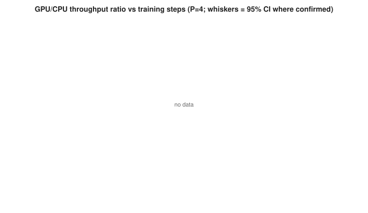
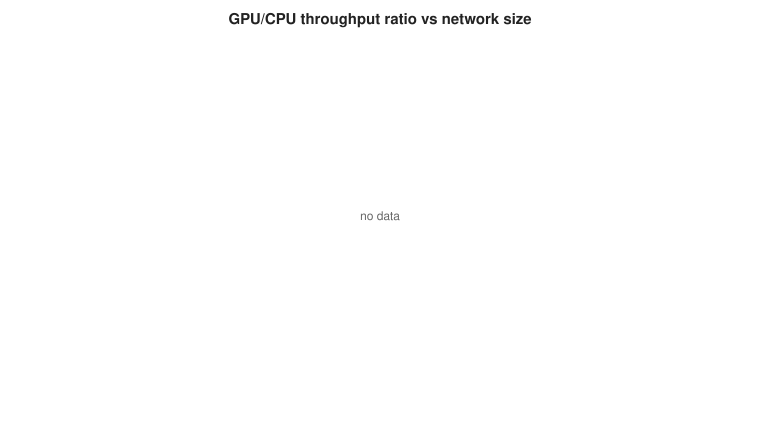
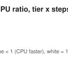
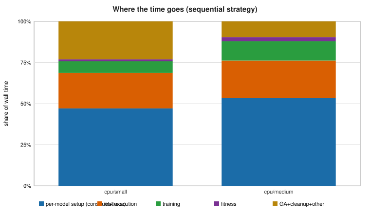

> **EXAMPLE ONLY - not a benchmark of your Mac.** A REAL run of `--tests scaling --quick --scaling-tiers small medium` in a Linux x86-64 cloud sandbox with
> CPU-only TensorFlow 2.15.1. There is no GPU there, so every GPU configuration is reported as *unsupported* (the suite never falls back to the CPU silently)
> and the status is `partial`. The CPU-side batching and multiprocessing results are real measurements of THAT sandbox, not of Apple Silicon.

# TensorFlow benchmark report

*Run `example_scaling_cpu_only` - started 2026-11-08T13:37:40+00:00 - finished 2026-11-08T13:38:37+00:00 - suite v2.0.0*

**Command:** `tf_memory_stress_test.py --tests scaling --quick --scaling-tiers small medium --scaling-max-total-min 7 --out-dir docs/example_scaling_cpu_only`

**Overall status:** INCOMPLETE (1 job(s) did not complete)

**How to read numbers:** **measured** = read directly from a clock, OS counter or TensorFlow; **calculated** = derived arithmetically from measured values (median, ratio, rate, slope); **estimated** = analytical model or heuristic; NOT observed.

## 1. Hardware and software configuration

| Item | Value |
|---|---|
| Machine | Linux-6.18.44-fc-v310-x86_64-with-glibc2.39 |
| Chip | x86_64 |
| Cores (P/E, logical) | None/None, 4 |
| GPU cores | n/a |
| Unified memory (GB) | 15.71 |
| OS | Linux-6.18.44-fc-v310-x86_64-with-glibc2.39 |
| Power source | n/a |
| Low Power Mode | n/a |
| Python | 3.11.18 |
| TensorFlow / Keras | 2.15.1 / 2.15.0 |
| tensorflow-metal | n/a |
| numpy / psutil | 1.26.4 / 7.2.2 |
| Seed | 1234 |

**Safety limits:** extra memory <= 6.0 GB, available >= 2.0 GB, system use < 80.0%, swap growth < 512.0 MB, runtime <= 20 min per benchmark.

## 2. TensorFlow and device configuration

_no data_

## 3. CPU and GPU performance (steady state)

_no data_

_Steps/s, samples/s, ms/step, median and CV are **calculated** from the measured per-repeat times._

**CPU vs GPU (calculated):**

_no data_

_The early trajectory compares the first ~10 training-step losses on both devices. Final losses are NOT compared as a pass/fail test: after hundreds of steps the models memorise the small data pool (loss ~1e-5) and float32 summation-order differences between CPU and GPU make relative differences of such tiny numbers large and meaningless (see `final_loss_rel_diff_informational` in report.json)._

**Forward-pass diagnosis (before any weight update; errors are relative to a float64 host calculation from the same weights and batch - measured):**

_no data_

_Same checksums on CPU and GPU = identical weights and data. Eager err small but graph err large = graph-mode op fusion on that device; graph fwd ok but first-step err large = the training step itself (variable update ordering etc.)._

**Phase breakdown (measured, seconds) - never merged with steady-state time:**

_no data_

**Thermal / stability indicators:**

_no data_

_`None`/`n/a` means the telemetry was unavailable, which does **not** mean no throttling occurred._

## 4. Baseline and peak memory

_no data_

_Peak extra memory = drop in system-available memory vs. the job's own baseline (captures unified/GPU memory that RSS misses). All **measured** (sampled ~0.5 s)._

## 5. Swap activity

_no data_

_no data_

## 6. Neuroevolution throughput

_no data_

## 7. Time per generation

## 8. Memory growth per generation / diagnostic

## 9. Incomplete or aborted tests

| Job | Status | Reason |
|---|---|---|
| scaling | partial | no paired CPU/GPU sequential measurement was completed (unsupported: no GPU is visible to TensorFlow (is tensorflow-metal installed and compatible?). Refusing to fall back to the CPU silently.) |

## 10. Measurement limitations and notes

- Single machine, single session: the coefficient of variation (CV) captures repeat-to-repeat noise only; session-to-session variance (background load, temperature, OS state) is unknown. Repeat on separate days before trusting small differences.
- System-memory figures come from psutil (macOS 'available' memory). They are coarse: they include file cache, macOS compresses memory, and values can lag or go negative. Peaks are sampled every ~0.5 s, so shorter spikes are missed.
- Process RSS excludes Metal/unified-memory buffers; GPU memory use is therefore visible only as a drop in system-available memory. tensorflow-metal does not implement tf.config.experimental.get_memory_info.
- GPU utilisation, GPU clocks and GPU temperature are not exposed through TensorFlow; `powermetrics` needs sudo and is not used. pmset thermal fields are coarse and may be absent - absence is NOT evidence of no throttling.
- TensorFlow offers no public API for the final per-op placement of a graph function. Device placement is verified from a probe op, every model variable, and (with soft placement OFF) from the fact that an op without a GPU kernel raises instead of moving. If placement is 'soft', some ops may have run on the CPU.
- Resource limits are enforced by an in-process watchdog (cooperative: checked between steps/individuals) and by an external supervisor that SIGTERM/SIGKILLs a worker that stays over a limit. A native call blocked inside Metal cannot be interrupted from Python; the supervisor is the backstop.
- GPU floating-point reductions are not bit-reproducible: seeds fix data, initialisation and the GA lineage, but numeric results can differ slightly between runs and between CPU and GPU.
- Workloads are synthetic: a dense MLP, a small convnet and small evolved MLPs. They do not represent transformers, large convolutional models or data-pipeline-bound training. Neuroevolution models are tiny, so that benchmark is dominated by per-model Keras/TensorFlow overhead and may favour the CPU.
- FLOP/s and pre-run memory figures are analytical ESTIMATES, not measurements.
- No performance claim is made about other Apple Silicon chips or memory sizes. Comparisons require actually running this suite (same TensorFlow/tensorflow-metal versions, seeds and settings) on the other machine.

## 11. Neuroevolution CPU/GPU scaling and crossover

**Status:** partial - no paired CPU/GPU sequential measurement was completed (unsupported: no GPU is visible to TensorFlow (is tensorflow-metal installed and compatible?). Refusing to fall back to the CPU silently.). Elapsed 0.9 min of a 7 min budget (per-configuration limit 2 min).

### 11.1 Design and coverage

| Item | Value |
|---|---|
| Exhaustive grid (tiers x populations x steps) | 16 workload points (x strategies x repetitions - NOT run) |
| Cell-runs executed (completed / not completed) | 18 / 4 |
| Skipped by budget or limits | 3 |
| Pilot / expansion / confirmation completed | 4 / 8 / 6 |
| Candidates carried into expansion | medium/P4/S20/hetero |
| Worker processes started | 11 |
| Workload | batch 128, input dim 32, G=2 generations, activations relu, tanh, seed 1234 |

Exploration (pilot, expansion) uses single runs and only SELECTS what to confirm; verdicts below come from independent repetitions (`confirmation`, 3 fresh processes, device order alternated).

### 11.2 Answers to the research questions

**1. Is GPU execution faster for any tested neuroevolution configuration?** *(evidence: none)*

NOT MEASURED: no paired CPU/GPU data were collected (see incomplete configurations).

**2. At what workload sizes does GPU execution become competitive?** *(evidence: none)*

NOT MEASURED: there is no paired CPU/GPU measurement, so nothing can be said about where the GPU becomes competitive.

**3. Which components dominate total runtime?** *(evidence: measured)*

cpu/small: per-model fixed work (construct+trace+first execution+fitness) 70%, training 7%, GA+cleanup 22.0%, unattributed 0.3%; cpu/medium: per-model fixed work (construct+trace+first execution+fitness) 79%, training 11%, GA+cleanup 9.3%, unattributed 0.2%

**4. Does GPU batching materially improve throughput?** *(evidence: confirmed)*

Batched vs sequential on the SAME device and workload (cross-strategy): homogeneous populations GPU n/a, CPU 2.29-3.60x (n=2); heterogeneous populations GPU n/a, CPU 1.03-1.03x (n=1); only 29% of heterogeneous individuals fell into a batchable bucket (median).

**5. How does memory usage scale with population and model complexity?** *(evidence: measured)*

Largest additional memory in any completed configuration: 0.08 GB (cpu-batched, medium, P=8, homo); maximum swap growth 0 MB. sequential strategies discard each model so their peak depends on model size, not population.

**6. What evidence supports or contradicts the proposed crossover?** *(evidence: none)*

0 point(s) have confirmation repetitions. Crossover status: no_paired_data. Confirmation agreed with exploration within 25% wherever both exist. No crossover is claimed because none was confirmed.

**7. Which findings are specific to TensorFlow Metal and this M1 Pro?** *(evidence: hypothesis)*

Observed on this software/hardware combination only: strict-placement kernel gaps are reported in the block table; results are valid only for the recorded TensorFlow / tensorflow-metal versions and `--grappler` setting. Whether this cost is a Metal-plugin limitation or a property of the M1 Pro GPU is NOT separable with this experiment.

**8. Which conclusions remain uncertain?** *(evidence: n/a)*

only 3 independent repetitions per confirmed point (wide intervals); one machine, one session; day-to-day variance (up to ~6% on throughput in earlier baselines) is not included in the CIs; cold vs warm Metal shader cache can change first-execution cost between sessions; break-even steps are model extrapolations; synthetic regression task and small dense networks only; paired comparisons use identical genomes/data but GPU reductions are not bit-reproducible; 4 configuration(s) did not complete and 3 were skipped by the budget/limits.

### 11.3 Crossover analysis (identical strategy: CPU sequential vs GPU sequential)

**Crossover status: `no_paired_data`** - confirmed points: 0 of 5.

| Tier | P | Steps | Exploration GPU/CPU | Confirmed GPU/CPU [95% CI] | Reps G/C | CPU CV | GPU CV | Verdict |
|---|---|---|---|---|---|---|---|---|
| small | 4 | 1 | n/a | n/a | 0/0 | n/a | n/a | no_data |
| small | 4 | 20 | n/a | n/a | 0/0 | n/a | n/a | no_data |
| medium | 4 | 1 | n/a | n/a | 0/0 | n/a | n/a | no_data |
| medium | 4 | 20 | n/a | n/a | 0/0 | n/a | n/a | no_data |
| medium | 8 | 20 | n/a | n/a | 0/0 | n/a | n/a | no_data |

### 11.4 Timing decomposition (sequential strategy, share of wall time)

| Device | Tier | Wall (s) | Evals | Construct | Trace | First exec | Train | Fitness | Teardown | GA | Cleanup | Unattributed |
|---|---|---|---|---|---|---|---|---|---|---|---|---|
| cpu | small | 1.84 | 14 | 13.9% | 32.2% | 22.7% | 7.3% | 1.1% | 0.5% | 0.0% | 21.9% | 0.3% |
| cpu | medium | 5.77 | 28 | 16.9% | 34.9% | 24.3% | 11.3% | 2.6% | 0.4% | 0.0% | 9.3% | 0.2% |

Components are measured per individual with host read-back barriers; *First exec* includes graph optimisation, kernel/shader compilation and training step #1.

### 11.5 Strategies: batching and CPU multiprocessing (different strategy, same workload and device)

| Point | Strategy | Pop. mode | Speed-up vs sequential | 95% CI | Evidence | Batchable members | Padding x | MP efficiency | Pool start-up (s) |
|---|---|---|---|---|---|---|---|---|---|
| medium/P4/S20/hetero | cpu-batched | hetero | 1.03 | n/a | exploration (1 rep) | 0.286 | 1.00 | n/a | n/a |
| medium/P4/S20/hetero | cpu-mp2 | hetero | 1.78 | n/a | exploration (1 rep) | n/a | n/a | 0.805 | 1.90 |
| medium/P4/S20/homo | cpu-batched | homo | 2.29 | n/a | exploration (1 rep) | 1.00 | 1.00 | n/a | n/a |
| medium/P4/S20/homo | cpu-mp2 | homo | 1.72 | n/a | exploration (1 rep) | n/a | n/a | 0.82 | 1.90 |
| medium/P8/S20/homo | cpu-batched | homo | 3.60 | [3.08, 4.19] | confirmed | 1.00 | 1.00 | n/a | n/a |

### 11.6 Memory

| Strategy | Tier | Pop. mode | P | Peak additional (GB) | Retained after cleanup (GB) | Swap growth (MB) | n |
|---|---|---|---|---|---|---|---|
| cpu-batched | medium | hetero | 4 | 0.00167 | 0.00558 | 0 | 1 |
| cpu-batched | medium | homo | 4 | 0.0349 | 0.0365 | 0 | 1 |
| cpu-batched | medium | homo | 8 | 0.0757 | 0.0643 | 0 | 4 |
| cpu-mp2 | medium | hetero | 4 | 0.02 | 5.34e-05 | 0 | 1 |
| cpu-mp2 | medium | homo | 4 | 0.0119 | 3.81e-06 | 0 | 1 |
| cpu-seq | medium | hetero | 4 | 0.011 | 0.00955 | 0 | 2 |
| cpu-seq | medium | hetero | 8 | 0.00518 | 0.0193 | 0 | 1 |
| cpu-seq | medium | homo | 4 | 0.0144 | 0.0163 | 0 | 1 |
| cpu-seq | medium | homo | 8 | 0.0192 | 0.0217 | 0 | 4 |
| cpu-seq | small | hetero | 4 | 0.00143 | 0.00146 | 0 | 2 |

Retained = process RSS after the cell's final `gc.collect()` minus RSS before the cell; allocator caching is NOT distinguished from retention here (use `memdiag` for that).

### 11.7 Cost model and ESTIMATED break-even (not measured)

_no data_

Two-parameter model per device and tier (fixed seconds per new model + seconds per training step) fitted to the measured components; break-even steps is an EXTRAPOLATION when above the tested range.

### 11.8 Execution-policy advisor (recommendation mode only)

| Device | Held-out MAPE | Cells | Per held-out tier |
|---|---|---|---|
| cpu | 54.8% | 1 | small: 55% |

Advisor reliable (held-out error <= 30% on both devices): **False**. Few tiers means a coarse test; 'reliable' = held-out MAPE <= 30% on both devices. An unreliable advisor still reports its predictions but always with confidence 'low'. Use `python tools/recommend_device.py <report.json> --params ... --layers ... --steps ... --population ...`; it prints advice only and never switches devices.

### 11.9 Incomplete, aborted, skipped and unsupported configurations

| Cell | Status | Reason |
|---|---|---|
| pilot:small/P4/S1/hetero:gpu-seq:r0 | unsupported | unsupported: no GPU is visible to TensorFlow (is tensorflow-metal installed and compatible?). Refusing to fall back to the CPU silently. |
| pilot:small/P4/S20/hetero:gpu-seq:r0 | unsupported | unsupported: no GPU is visible to TensorFlow (is tensorflow-metal installed and compatible?). Refusing to fall back to the CPU silently. |
| pilot:medium/P4/S1/hetero:gpu-seq:r0 | unsupported | unsupported: no GPU is visible to TensorFlow (is tensorflow-metal installed and compatible?). Refusing to fall back to the CPU silently. |
| pilot:medium/P4/S20/hetero:gpu-seq:r0 | unsupported | unsupported: no GPU is visible to TensorFlow (is tensorflow-metal installed and compatible?). Refusing to fall back to the CPU silently. |

Skipped before running (budget, memory estimate, pruning):

| Cell | Reason |
|---|---|
| confirmation:medium/P8/S20/homo:gpu-batched:r0 | strategy unavailable: unsupported: no GPU is visible to TensorFlow (is tensorflow-metal installed and compatible?). Refusing to fall back to the CPU s |
| confirmation:medium/P8/S20/homo:gpu-batched:r1 | strategy unavailable: unsupported: no GPU is visible to TensorFlow (is tensorflow-metal installed and compatible?). Refusing to fall back to the CPU s |
| confirmation:medium/P8/S20/homo:gpu-batched:r2 | strategy unavailable: unsupported: no GPU is visible to TensorFlow (is tensorflow-metal installed and compatible?). Refusing to fall back to the CPU s |

Unavailable strategies: `gpu-*` - unsupported: no GPU is visible to TensorFlow (is tensorflow-metal installed and compatible?). Refusing to fall back to the CPU silently.

An aborted, failed, skipped or unsupported configuration is never counted as a performance measurement.

### 11.10 Hardware-purchasing implications and limitations

- For neuroevolution workloads like those tested (new model per individual, <= 50 steps), the CPU path was at least as fast; buying more GPU cores alone is not supported by this evidence for such workloads.
- The per-model fixed cost (tracing, first execution) is the term that decides the outcome for small networks; this suite cannot tell whether a different Apple Silicon chip reduces it. Only running `tf_memory_stress_test.py --tests scaling` on that machine can.
- CPU multiprocessing reached 1.78x over sequential CPU (cpu-mp2, efficiency 81%); if your engine can evaluate individuals in parallel, CPU core count is a relevant purchase dimension.
- Memory: see Q5; peak additional memory in these experiments is the measured figure to compare with candidate RAM sizes. No performance numbers are inferred for untested processors.
- Valid only for the recorded TensorFlow / tensorflow-metal versions, `--grappler` setting, `SimpleAdam` optimizer and synthetic regression task.
- Exploration runs are single measurements; CIs use only confirmation repetitions (small n -> wide intervals).
- Multiprocessing uses CPU only, one thread per worker; GPU multiprocessing is deliberately not supported (shared Metal device and unified memory).
- Batching of heterogeneous populations uses bucketing by (depth, activations) with zero-padding of widths; its coverage and padding overhead are reported, not hidden.
- No performance is inferred for any Apple Silicon processor that was not benchmarked.
