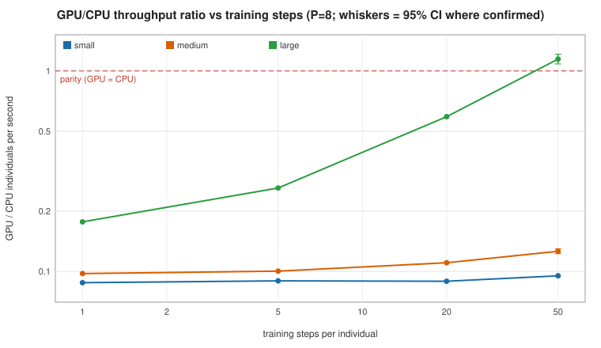
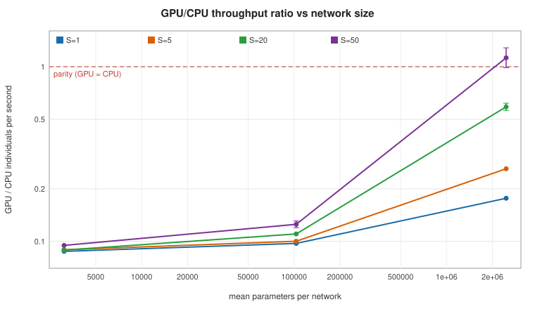
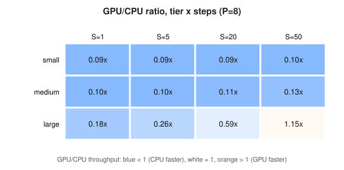
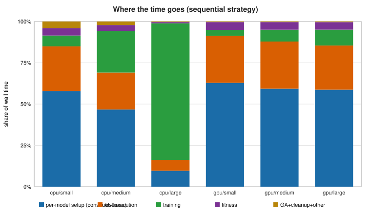

> **SYNTHETIC ILLUSTRATION - not a measurement.** Generated from a known ground-truth cost model to show the report layout and to test the analysis; it says nothing about any real machine.

## 11. Neuroevolution CPU/GPU scaling and crossover

**Status:** completed. Elapsed 24.1 min of a 30 min budget (per-configuration limit 5 min).

### 11.1 Design and coverage

| Item | Value |
|---|---|
| Exhaustive grid (tiers x populations x steps) | 48 workload points (x strategies x repetitions - NOT run) |
| Cell-runs executed (completed / not completed) | 74 / 0 |
| Skipped by budget or limits | 14 |
| Pilot / expansion / confirmation completed | 24 / 26 / 24 |
| Candidates carried into expansion | large/P8/S50/hetero, medium/P8/S50/hetero |
| Worker processes started | 17 |
| Workload | batch 128, input dim 32, G=3 generations, activations relu, tanh, seed 1234 |

Exploration (pilot, expansion) uses single runs and only SELECTS what to confirm; verdicts below come from independent repetitions (`confirmation`, 3 fresh processes, device order alternated).

### 11.2 Answers to the research questions

**1. Is GPU execution faster for any tested neuroevolution configuration?** *(evidence: unconfirmed)*

POSSIBLY: exploration runs show GPU > CPU at large/P4/S50/hetero, large/P8/S50/hetero, but these were not confirmed with independent repetitions, so no claim is made. Cross-strategy (best available strategy on each device, exploration data): GPU ahead at large/P4/S50/hetero (seq vs seq, 1.08x). CAVEAT: CPU multiprocessing was NOT measured at large/P4/S50/hetero, so the best CPU strategy there may be faster than shown.

**2. At what workload sizes does GPU execution become competitive?** *(evidence: estimated)*

GPU reached >= 50% of CPU throughput (a definition of 'competitive', not a measurement) at: large/P4/S50/hetero (1.08x), large/P8/S20/hetero (0.59x), large/P8/S50/hetero (1.13x). Tier 'small': no break-even from the fitted model (GPU per-step cost is not lower than CPU's). Tier 'medium': no break-even from the fitted model (GPU per-step cost is not lower than CPU's). ESTIMATED (model extrapolation, not measured) break-even for tier 'large': ~42 training steps per individual (inside the tested range).

**3. Which components dominate total runtime?** *(evidence: measured)*

cpu/small: per-model fixed work (construct+trace+first execution+fitness) 89%, training 7%, GA+cleanup 4.0%, unattributed 0.0%; cpu/medium: per-model fixed work (construct+trace+first execution+fitness) 75%, training 22%, GA+cleanup 2.6%, unattributed 0.0%; cpu/large: per-model fixed work (construct+trace+first execution+fitness) 19%, training 80%, GA+cleanup 0.4%, unattributed 0.0%; gpu/small: per-model fixed work (construct+trace+first execution+fitness) 96%, training 4%, GA+cleanup 0.4%, unattributed 0.0%; gpu/medium: per-model fixed work (construct+trace+first execution+fitness) 93%, training 7%, GA+cleanup 0.4%, unattributed 0.0%; gpu/large: per-model fixed work (construct+trace+first execution+fitness) 92%, training 8%, GA+cleanup 0.3%, unattributed 0.0%

**4. Does GPU batching materially improve throughput?** *(evidence: unconfirmed)*

Batched vs sequential on the SAME device and workload (cross-strategy): homogeneous populations GPU 1.96-2.06x (n=2), CPU 1.96-2.00x (n=2); heterogeneous populations GPU 1.36-1.39x (n=2), CPU 1.29-1.39x (n=2); only 40% of heterogeneous individuals fell into a batchable bucket (median). Identical-strategy comparison, GPU-batched vs CPU-batched (GPU/CPU throughput): medium/P8/S50/hetero: 0.12x (single exploration run, no CI); medium/P8/S50/homo: 0.13x (single exploration run, no CI); large/P8/S50/hetero: 1.18x (single exploration run, no CI); large/P8/S50/homo: 1.16x (single exploration run, no CI).

**5. How does memory usage scale with population and model complexity?** *(evidence: measured)*

Largest additional memory in any completed configuration: 1.54 GB (gpu-batched, large, P=8, hetero); maximum swap growth 0 MB. sequential strategies discard each model so their peak depends on model size, not population.

**6. What evidence supports or contradicts the proposed crossover?** *(evidence: confirmed)*

3 point(s) have confirmation repetitions. Crossover status: candidate_unconfirmed. Confirmation agreed with exploration within 25% wherever both exist. No crossover is claimed because none was confirmed.

**7. Which findings are specific to TensorFlow Metal and this M1 Pro?** *(evidence: hypothesis)*

Observed on this software/hardware combination only: per-model graph tracing/first execution accounts for 91% of GPU wall time at its worst tier, consistent with a per-model compilation/dispatch cost on tensorflow-metal; strict-placement kernel gaps are reported in the block table; results are valid only for the recorded TensorFlow / tensorflow-metal versions and `--grappler` setting. Whether this cost is a Metal-plugin limitation or a property of the M1 Pro GPU is NOT separable with this experiment.

**8. Which conclusions remain uncertain?** *(evidence: n/a)*

only 3 independent repetitions per confirmed point (wide intervals); one machine, one session; day-to-day variance (up to ~6% on throughput in earlier baselines) is not included in the CIs; cold vs warm Metal shader cache can change first-execution cost between sessions; break-even steps are model extrapolations; synthetic regression task and small dense networks only; paired comparisons use identical genomes/data but GPU reductions are not bit-reproducible; 0 configuration(s) did not complete and 14 were skipped by the budget/limits.

### 11.3 Crossover analysis (identical strategy: CPU sequential vs GPU sequential)

**Crossover status: `candidate_unconfirmed`** - confirmed points: 3 of 16.

| Tier | P | Steps | Exploration GPU/CPU | Confirmed GPU/CPU [95% CI] | Reps G/C | CPU CV | GPU CV | Verdict |
|---|---|---|---|---|---|---|---|---|
| small | 8 | 1 | 0.0878 | n/a | 0/0 | n/a | n/a | unconfirmed |
| small | 8 | 5 | 0.0897 | n/a | 0/0 | n/a | n/a | unconfirmed |
| small | 8 | 20 | 0.0893 | n/a | 0/0 | n/a | n/a | unconfirmed |
| small | 8 | 50 | 0.095 | n/a | 0/0 | n/a | n/a | unconfirmed |
| medium | 4 | 50 | 0.133 | n/a | 0/0 | n/a | n/a | unconfirmed |
| medium | 8 | 1 | 0.0975 | n/a | 0/0 | n/a | n/a | unconfirmed |
| medium | 8 | 5 | 0.1 | n/a | 0/0 | n/a | n/a | unconfirmed |
| medium | 8 | 20 | 0.11 | n/a | 0/0 | n/a | n/a | unconfirmed |
| medium | 8 | 50 | 0.124 | 0.125 [0.12, 0.131] | 3/3 | 0.0187 | 0.0203 | cpu_faster |
| medium | 16 | 50 | n/a | n/a | 0/0 | n/a | n/a | no_data |
| large | 4 | 50 | 1.08 | n/a | 0/0 | n/a | n/a | unconfirmed |
| large | 8 | 1 | 0.177 | n/a | 0/0 | n/a | n/a | unconfirmed |
| large | 8 | 5 | 0.261 | n/a | 0/0 | n/a | n/a | unconfirmed |
| large | 8 | 20 | 0.592 | 0.59 [0.563, 0.618] | 3/3 | 0.0229 | 0.0145 | cpu_faster |
| large | 8 | 50 | 1.10 | 1.13 [0.987, 1.28] | 3/3 | 0.0573 | 0.0193 | inconclusive |
| large | 16 | 50 | n/a | n/a | 0/0 | n/a | n/a | no_data |

- *Candidate, NOT confirmed*: ratio crosses 1 along training steps between 20 and 50.
- *Candidate, NOT confirmed*: ratio crosses 1 along model size (mean parameters) between 103281 and 2.45997e+06.
- *Candidate, NOT confirmed*: ratio crosses 1 along model size (mean parameters) between 66705 and 2.99334e+06.

**Batched strategy, CPU vs GPU (identical strategy, same workload):**

| Point | Exploration GPU/CPU | Confirmed [95% CI] | Verdict |
|---|---|---|---|
| medium/P8/S50/hetero | 0.121 | n/a | unconfirmed |
| medium/P8/S50/homo | 0.127 | n/a | unconfirmed |
| large/P8/S50/hetero | 1.18 | n/a | unconfirmed |
| large/P8/S50/homo | 1.16 | n/a | unconfirmed |







### 11.4 Timing decomposition (sequential strategy, share of wall time)

| Device | Tier | Wall (s) | Evals | Construct | Trace | First exec | Train | Fitness | Teardown | GA | Cleanup | Unattributed |
|---|---|---|---|---|---|---|---|---|---|---|---|---|
| cpu | small | 9.03 | 80 | 22.2% | 35.7% | 27.0% | 6.6% | 4.5% | 0.0% | 1.3% | 2.7% | 0.0% |
| cpu | medium | 30.61 | 190 | 18.8% | 29.7% | 22.9% | 22.2% | 3.7% | 0.0% | 0.9% | 1.8% | 0.0% |
| cpu | large | 299.66 | 250 | 4.1% | 6.7% | 7.6% | 80.4% | 0.8% | 0.0% | 0.1% | 0.2% | 0.0% |
| gpu | small | 99.74 | 80 | 24.4% | 38.4% | 28.4% | 3.7% | 4.7% | 0.0% | 0.1% | 0.2% | 0.0% |
| gpu | medium | 202.79 | 150 | 22.8% | 36.9% | 28.2% | 7.1% | 4.7% | 0.0% | 0.1% | 0.2% | 0.0% |
| gpu | large | 299.57 | 210 | 22.8% | 36.8% | 27.5% | 8.1% | 4.5% | 0.0% | 0.1% | 0.2% | 0.0% |

Components are measured per individual with host read-back barriers; *First exec* includes graph optimisation, kernel/shader compilation and training step #1.



### 11.5 Strategies: batching and CPU multiprocessing (different strategy, same workload and device)

| Point | Strategy | Pop. mode | Speed-up vs sequential | 95% CI | Evidence | Batchable members | Padding x | MP efficiency | Pool start-up (s) |
|---|---|---|---|---|---|---|---|---|---|
| large/P8/S50/hetero | cpu-batched | hetero | 1.29 | n/a | exploration (1 rep) | 0.4 | 1.30 | n/a | n/a |
| large/P8/S50/hetero | cpu-mp2 | hetero | 1.47 | n/a | exploration (1 rep) | n/a | n/a | 0.75 | 6.00 |
| large/P8/S50/hetero | cpu-mp4 | hetero | 2.86 | n/a | exploration (1 rep) | n/a | n/a | 0.75 | 6.00 |
| large/P8/S50/hetero | gpu-batched | hetero | 1.39 | n/a | exploration (1 rep) | 0.4 | 1.30 | n/a | n/a |
| large/P8/S50/homo | cpu-batched | homo | 1.96 | n/a | exploration (1 rep) | 1.00 | 1.00 | n/a | n/a |
| large/P8/S50/homo | cpu-mp2 | homo | 1.53 | n/a | exploration (1 rep) | n/a | n/a | 0.75 | 6.00 |
| large/P8/S50/homo | cpu-mp4 | homo | 3.00 | n/a | exploration (1 rep) | n/a | n/a | 0.75 | 6.00 |
| large/P8/S50/homo | gpu-batched | homo | 1.96 | n/a | exploration (1 rep) | 1.00 | 1.00 | n/a | n/a |
| medium/P8/S50/hetero | cpu-batched | hetero | 1.39 | n/a | exploration (1 rep) | 0.4 | 1.30 | n/a | n/a |
| medium/P8/S50/hetero | cpu-mp2 | hetero | 1.50 | n/a | exploration (1 rep) | n/a | n/a | 0.75 | 6.00 |
| medium/P8/S50/hetero | cpu-mp4 | hetero | 2.99 | n/a | exploration (1 rep) | n/a | n/a | 0.75 | 6.00 |
| medium/P8/S50/hetero | gpu-batched | hetero | 1.36 | n/a | exploration (1 rep) | 0.4 | 1.30 | n/a | n/a |
| medium/P8/S50/homo | cpu-batched | homo | 2.00 | n/a | exploration (1 rep) | 1.00 | 1.00 | n/a | n/a |
| medium/P8/S50/homo | cpu-mp2 | homo | 1.50 | n/a | exploration (1 rep) | n/a | n/a | 0.75 | 6.00 |
| medium/P8/S50/homo | cpu-mp4 | homo | 2.97 | [2.84, 3.12] | confirmed | n/a | n/a | 0.75 | 6.00 |
| medium/P8/S50/homo | gpu-batched | homo | 2.06 | n/a | exploration (1 rep) | 1.00 | 1.00 | n/a | n/a |

**Best available strategy per device (cross-strategy, exploration data):**

| Point | Pop. mode | Best CPU | CPU ind/s | Best GPU | GPU ind/s | GPU/CPU | CPU multiprocessing measured |
|---|---|---|---|---|---|---|---|
| small/P8/S1/hetero | hetero | seq | 9.52 | seq | 0.836 | 0.0878 | False |
| small/P8/S5/hetero | hetero | seq | 9.24 | seq | 0.828 | 0.0897 | False |
| small/P8/S20/hetero | hetero | seq | 8.94 | seq | 0.798 | 0.0893 | False |
| medium/P8/S1/hetero | hetero | seq | 8.22 | seq | 0.802 | 0.0975 | False |
| medium/P8/S5/hetero | hetero | seq | 7.68 | seq | 0.77 | 0.1 | False |
| small/P8/S50/hetero | hetero | seq | 7.91 | seq | 0.752 | 0.095 | False |
| medium/P8/S20/hetero | hetero | seq | 7.00 | seq | 0.773 | 0.11 | False |
| medium/P8/S50/hetero | hetero | mp4 | 17.13 | batched | 0.965 | 0.0563 | True |
| large/P8/S1/hetero | hetero | seq | 4.27 | seq | 0.754 | 0.177 | False |
| large/P8/S5/hetero | hetero | seq | 2.87 | seq | 0.748 | 0.261 | False |
| large/P8/S20/hetero | hetero | seq | 1.23 | seq | 0.727 | 0.592 | False |
| large/P8/S50/hetero | hetero | mp4 | 1.73 | batched | 0.922 | 0.532 | True |
| medium/P8/S50/homo | homo | mp4 | 17.24 | batched | 1.44 | 0.0833 | True |
| large/P8/S50/homo | homo | mp4 | 1.75 | batched | 1.33 | 0.758 | True |
| medium/P4/S50/hetero | hetero | seq | 5.50 | seq | 0.733 | 0.133 | False |
| large/P4/S50/hetero | hetero | seq | 0.609 | seq | 0.657 | 1.08 | False |

### 11.6 Memory

| Strategy | Tier | Pop. mode | P | Peak additional (GB) | Retained after cleanup (GB) | Swap growth (MB) | n |
|---|---|---|---|---|---|---|---|
| cpu-batched | large | hetero | 8 | 0.74 | 0.02 | 0 | 1 |
| cpu-batched | large | homo | 8 | 0.74 | 0.02 | 0 | 1 |
| cpu-batched | medium | hetero | 8 | 0.18 | 0.02 | 0 | 1 |
| cpu-batched | medium | homo | 8 | 0.18 | 0.02 | 0 | 1 |
| cpu-mp2 | large | hetero | 8 | 0.18 | 0.02 | 0 | 1 |
| cpu-mp2 | large | homo | 8 | 0.18 | 0.02 | 0 | 1 |
| cpu-mp2 | medium | hetero | 8 | 0.11 | 0.02 | 0 | 1 |
| cpu-mp2 | medium | homo | 8 | 0.11 | 0.02 | 0 | 1 |
| cpu-mp4 | large | hetero | 8 | 0.18 | 0.02 | 0 | 1 |
| cpu-mp4 | large | homo | 8 | 0.18 | 0.02 | 0 | 1 |
| cpu-mp4 | medium | hetero | 8 | 0.11 | 0.02 | 0 | 1 |
| cpu-mp4 | medium | homo | 8 | 0.11 | 0.02 | 0 | 4 |
| cpu-seq | large | hetero | 4 | 0.18 | 0.02 | 0 | 1 |
| cpu-seq | large | hetero | 8 | 0.18 | 0.02 | 0 | 10 |
| cpu-seq | large | hetero | 16 | 0.18 | 0.02 | 0 | 1 |
| cpu-seq | large | homo | 8 | 0.18 | 0.02 | 0 | 1 |
| cpu-seq | medium | hetero | 4 | 0.11 | 0.02 | 0 | 1 |
| cpu-seq | medium | hetero | 8 | 0.11 | 0.02 | 0 | 7 |
| cpu-seq | medium | hetero | 16 | 0.11 | 0.02 | 0 | 1 |
| cpu-seq | medium | homo | 8 | 0.11 | 0.02 | 0 | 4 |
| cpu-seq | small | hetero | 8 | 0.102 | 0.02 | 0 | 4 |
| gpu-batched | large | hetero | 8 | 1.54 | 0.02 | 0 | 1 |
| gpu-batched | large | homo | 8 | 1.54 | 0.02 | 0 | 1 |
| gpu-batched | medium | hetero | 8 | 0.98 | 0.02 | 0 | 1 |
| gpu-batched | medium | homo | 8 | 0.98 | 0.02 | 0 | 1 |
| gpu-seq | large | hetero | 4 | 0.98 | 0.02 | 0 | 1 |
| gpu-seq | large | hetero | 8 | 0.98 | 0.02 | 0 | 10 |
| gpu-seq | large | homo | 8 | 0.98 | 0.02 | 0 | 1 |
| gpu-seq | medium | hetero | 4 | 0.91 | 0.02 | 0 | 1 |
| gpu-seq | medium | hetero | 8 | 0.91 | 0.02 | 0 | 7 |
| gpu-seq | medium | homo | 8 | 0.91 | 0.02 | 0 | 1 |
| gpu-seq | small | hetero | 8 | 0.902 | 0.02 | 0 | 4 |

Retained = process RSS after the cell's final `gc.collect()` minus RSS before the cell; allocator caching is NOT distinguished from retention here (use `memdiag` for that).

### 11.7 Cost model and ESTIMATED break-even (not measured)

| Tier | GPU fixed/model (s) | GPU s/step | CPU fixed/model (s) | CPU s/step | Break-even steps (estimated) | Inside tested range |
|---|---|---|---|---|---|---|
| small | 1.19 | 0.00253 | 0.101 | 0.000406 | GPU per-step cost is not lower than CPU's | False |
| medium | 1.25 | 0.00299 | 0.121 | 0.001 | GPU per-step cost is not lower than CPU's | False |
| large | 1.31 | 0.00408 | 0.199 | 0.0303 | 42 | True |

Two-parameter model per device and tier (fixed seconds per new model + seconds per training step) fitted to the measured components; break-even steps is an EXTRAPOLATION when above the tested range.

### 11.8 Execution-policy advisor (recommendation mode only)

| Device | Held-out MAPE | Cells | Per held-out tier |
|---|---|---|---|
| cpu | 43.6% | 22 | large: 45%, medium: 39%, small: 50% |
| gpu | 11.6% | 20 | large: 22%, medium: 2%, small: 0% |

Advisor reliable (held-out error <= 30% on both devices): **False**. Few tiers means a coarse test; 'reliable' = held-out MAPE <= 30% on both devices. An unreliable advisor still reports its predictions but always with confidence 'low'. Use `python tools/recommend_device.py <report.json> --params ... --layers ... --steps ... --population ...`; it prints advice only and never switches devices.

### 11.9 Incomplete, aborted, skipped and unsupported configurations

No configuration ended aborted/failed/unsupported.

Skipped before running (budget, memory estimate, pruning):

| Cell | Reason |
|---|---|
| expansion:large/P32/S50/hetero:cpu-seq:r0 | expansion time budget exhausted |
| expansion:large/P32/S50/hetero:gpu-seq:r0 | expansion time budget exhausted |
| expansion:medium/P32/S50/hetero:cpu-seq:r0 | expansion time budget exhausted |
| expansion:medium/P32/S50/hetero:gpu-seq:r0 | expansion time budget exhausted |
| expansion:large/P32/S50/homo:cpu-seq:r0 | expansion time budget exhausted |
| expansion:large/P32/S50/homo:cpu-batched:r0 | expansion time budget exhausted |
| expansion:large/P32/S50/homo:gpu-seq:r0 | expansion time budget exhausted |
| expansion:large/P32/S50/homo:gpu-batched:r0 | expansion time budget exhausted |
| expansion:medium/P32/S50/homo:cpu-seq:r0 | expansion time budget exhausted |
| expansion:medium/P32/S50/homo:cpu-batched:r0 | expansion time budget exhausted |
| expansion:medium/P32/S50/homo:gpu-seq:r0 | expansion time budget exhausted |
| expansion:medium/P32/S50/homo:gpu-batched:r0 | expansion time budget exhausted |
| expansion:medium/P16/S50/hetero:gpu-seq:r0 | expansion time budget exhausted |
| expansion:large/P16/S50/hetero:gpu-seq:r0 | expansion time budget exhausted |

An aborted, failed, skipped or unsupported configuration is never counted as a performance measurement.

### 11.10 Hardware-purchasing implications and limitations

- For neuroevolution workloads like those tested (new model per individual, <= 50 steps), the CPU path was at least as fast; buying more GPU cores alone is not supported by this evidence for such workloads.
- The per-model fixed cost (tracing, first execution) is the term that decides the outcome for small networks; this suite cannot tell whether a different Apple Silicon chip reduces it. Only running `tf_memory_stress_test.py --tests scaling` on that machine can.
- CPU multiprocessing reached 3.00x over sequential CPU (cpu-mp4, efficiency 75%); if your engine can evaluate individuals in parallel, CPU core count is a relevant purchase dimension.
- Memory: see Q5; peak additional memory in these experiments is the measured figure to compare with candidate RAM sizes. No performance numbers are inferred for untested processors.
- Valid only for the recorded TensorFlow / tensorflow-metal versions, `--grappler` setting, `SimpleAdam` optimizer and synthetic regression task.
- Exploration runs are single measurements; CIs use only confirmation repetitions (small n -> wide intervals).
- Multiprocessing uses CPU only, one thread per worker; GPU multiprocessing is deliberately not supported (shared Metal device and unified memory).
- Batching of heterogeneous populations uses bucketing by (depth, activations) with zero-padding of widths; its coverage and padding overhead are reported, not hidden.
- No performance is inferred for any Apple Silicon processor that was not benchmarked.

### Synthetic ground truth (known only because this data was generated)

```json
{
  "truth_seconds_per_model_and_per_step": {
    "cpu|small": {
      "fixed_s_per_model": 0.1,
      "s_per_step": 0.0004
    },
    "cpu|medium": {
      "fixed_s_per_model": 0.12,
      "s_per_step": 0.001
    },
    "cpu|large": {
      "fixed_s_per_model": 0.2,
      "s_per_step": 0.03
    },
    "gpu|small": {
      "fixed_s_per_model": 1.2,
      "s_per_step": 0.0025
    },
    "gpu|medium": {
      "fixed_s_per_model": 1.25,
      "s_per_step": 0.003
    },
    "gpu|large": {
      "fixed_s_per_model": 1.3,
      "s_per_step": 0.004
    }
  },
  "true_break_even_steps": {
    "small": null,
    "medium": null,
    "large": 42.307692307692314
  }
}
```
